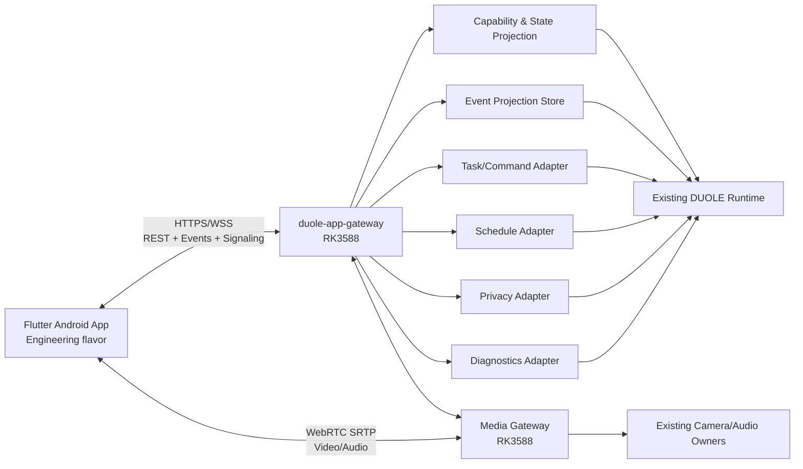
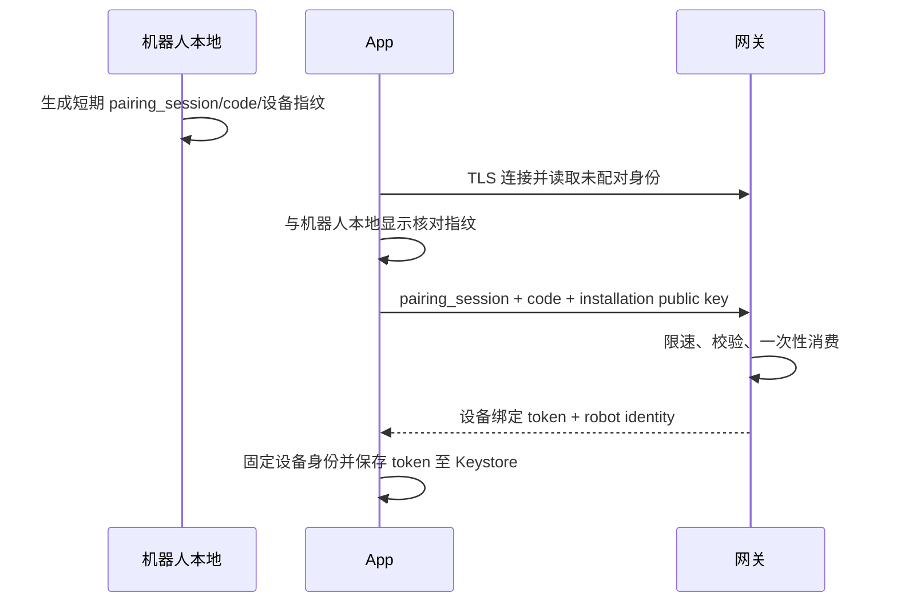
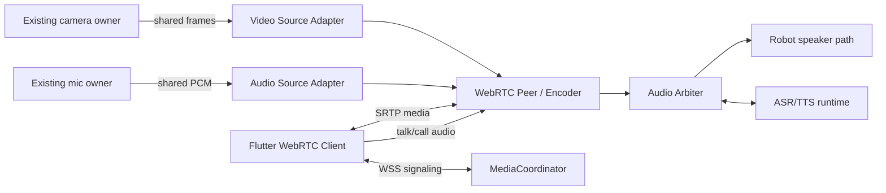
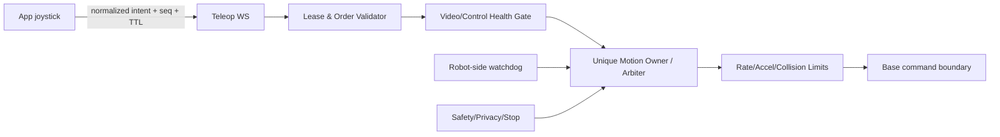

# 多乐守护 Engineering V1 参考架构

Status: `ready-for-human`

本文件是建议实现架构，不代表仓库当前已有这些组件。Engineering V1 的目标是在机器人与
Android 手机处于同一受控局域网时，形成真实、可诊断、可安全停止的操作闭环。

## 1. 架构约束

1. App 不加入 ROS 2/DDS，不知道 Topic、Action、QoS 或进程名。
2. RK3588 上新增唯一 App 边界 `duole-app-gateway`。
3. 网关适配现有领域服务，不复制日程数据库、任务状态机或隐私事实。
4. 任务控制使用 `job_id` 和明确终态；实时遥控使用短租约和机器人端 watchdog。
5. 媒体服务附着现有相机/麦克风链，不争抢硬件 owner。
6. 广播发现不建立信任；配对固定设备身份。
7. 所有 capability 和健康状态由机器人端动态返回。
8. 工程与家庭使用同一代码库、不同 build flavor；家庭构建在编译和路由层移除工程诊断。

## 2. 系统上下文



网关是应用边界，不是新的业务“大脑”。现有正式启动入口、TaskCoordinator、Schedule、
Device Status、视觉监护和导航合同仍拥有各自事实。

## 3. 推荐技术栈

| 层 | 建议 | 原因与边界 |
|---|---|---|
| App | Flutter / Dart | Android E1 快速交付，并保留后续 iOS 代码路径 |
| Android 目标 | Android APK | Windows 可完整构建与验收；iOS 留到 Mac 环境验证 |
| 网关 | Python + FastAPI | 与现有 Python 业务适配成本低，生成 OpenAPI，支持 REST/WS |
| 事件 | WebSocket + 本地有界投影存储 | 实时推送、游标补拉、断线恢复 |
| 媒体 | WebRTC P2P（E1） | 局域网低延迟、加密媒体、单手机足够 |
| 发现 | mDNS/DNS-SD + 手动 IP | 首选易用发现，失败时可诊断连接 |
| schema | OpenAPI 3.1 + JSON Schema | 生成 Dart 模型并做兼容测试 |
| 本地安全存储 | Android Keystore 封装 | 保存设备绑定凭据 |

WebRTC 具体库和硬件编码路径必须通过技术预研选择，不能仅凭 API 美观决定。媒体层应定义
端口接口，未来可由 P2P 替换为云端 SFU，而不改页面业务模型。

## 4. App 分层

```text
presentation
  页面、组件、设计令牌、无障碍
application
  connect / live / teleop / jobs / schedules / diagnostics 用例
domain
  RobotState、Capability、Incident、Job、Schedule、MediaSession
infrastructure
  REST client、Event WS、WebRTC、mDNS、secure storage、local cache
```

- Domain 不依赖 Flutter widget、IP 地址或 ROS 名称。
- REST 与 WS 模型由同一 schema 生成；未知 enum 值保留为 `unknown`，不能使 App 崩溃。
- 本地缓存只用于启动占位和诊断；每条缓存带服务器时间、快照序列和陈旧标志。
- feature gate 同时检查 build flavor、服务端 capability 和授权 scope。
- App 生命周期协调器统一处理后台、锁屏、音频焦点和遥控释放。

## 5. 网关内部模块

| 模块 | 职责 | 不得做的事 |
|---|---|---|
| `DiscoveryIdentity` | mDNS 元数据、设备身份、配对、令牌撤销 | 信任广播中的 IP/名称作为身份 |
| `SessionAuth` | 校验本地令牌、scope、安装实例和请求 TTL | 用客户端显示名判权 |
| `CapabilityService` | 聚合版本、模式、能力和依赖健康 | 把“进程存在”当能力可用 |
| `StateProjection` | 投影设备状态与更新时间 | 自建与领域服务冲突的真相 |
| `EventBridge` | 统一事件 envelope、序列、去重、补拉 | 重算跌倒/安全概率 |
| `JobGateway` | 创建/查询/取消导航、巡逻、回充任务 | 直接把 HTTP 成功当任务成功 |
| `MotionGateway` | teleop 租约、序列、watchdog、停止联锁 | 将手机作为最终限速器 |
| `ScheduleGateway` | 复用正式日程服务，补足版本化用例 | 新建 App 专属日程 DB |
| `PrivacyGateway` | 读取/请求视觉策略，执行媒体/运动联动 | 绕过本地隐私锁 |
| `MediaCoordinator` | 创建媒体会话、音频模式和机器人提示 | 第二次打开相机设备 |
| `Diagnostics` | 版本、关联 ID、脱敏导出 | 导出 token、音视频、原始对话 |

建议网关进程崩溃时由系统 supervisor 重启，但运动停止不能依赖进程成功重启；底盘/运动侧
watchdog 必须在更靠近执行器的安全边界独立生效。

## 6. 连接、发现与信任建立

### 6.1 mDNS

建议服务类型 `_duole-app._tcp.local`，TXT 只公布非敏感提示：

```text
robot_id_hint, display_name, api_major, gateway_version, mode, tls_required
```

App 把发现结果作为候选，连接后必须用受保护的身份端点核对完整 `robot_id` 与设备公钥。
同名设备按稳定 ID 区分。Android mDNS 权限、组播锁和部分路由器屏蔽组播需纳入实机测试。

### 6.2 手动 IP

用户输入 `host[:port]` 后走完全相同的 TLS、版本、身份和配对校验。不得为手动 IP 提供
“忽略证书并永久继续”。临时诊断错误可以展示证书指纹，但是否信任必须与机器人本地显示
一致。

### 6.3 E1 配对建议



如果最终选择 PAKE 或二维码承载公钥，可替换配对实现，但必须满足：局域网窃听者拿不到可
重放凭据、错误尝试限速、码成功后立即失效、设备密钥变化可见。

## 7. API 与版本策略

- REST 基路径 `/api/v1`；WebSocket 事件也声明 `schema_version`。
- `api_major` 不兼容时禁止写操作，仍允许打开兼容性诊断。
- 新增可选字段属于向后兼容；删除字段、改变含义或 enum 复用需要升 major。
- 时间统一传 RFC 3339（含偏移）并附 `server_time`；持续时长用毫秒整数。
- 所有写响应回显 `request_id`；任务响应包含 `job_id`。
- OpenAPI 和事件 JSON Schema 在 CI 做生成模型差异检查与契约测试。

具体建议接口见 [API_CONTRACT.md](API_CONTRACT.md)。

## 8. 状态快照与事件一致性

### 8.1 快照

聚合快照应包含：

```text
snapshot_seq
server_time
robot identity + mode
capabilities + reasons
device states + freshness
active incidents
active jobs
today schedules summary
privacy/media state
```

聚合快照用于建立一致起点，不能由 App 并发请求多个端点后自行猜测先后。

### 8.2 事件 envelope

每个事件有机器人范围内单调递增 `seq`、全局稳定 `event_id`、发生时间和类型。桥接来源重复
上报时按 `source + source_event_id` 去重；跌倒生命周期按 `incident_id` 聚合。

### 8.3 重连算法

1. App 保存最后成功应用的 `seq`，而非最后收到的网络包。
2. 重连请求快照和 `from_seq`。
3. 网关返回缺失事件，直到 `sync.complete`。
4. App 按 seq 应用；重复 ID 忽略，缺口则暂停写操作并请求 resync。
5. 任何 `request_id` 结果不明确时查询命令状态，不自动重发写请求。

本地事件投影使用有界、轮转存储。最低保留窗口由断线验收与磁盘容量 spike 决定，并在
能力响应中公布 `earliest_available_seq`；超出窗口强制完整同步。

## 9. 领域适配

### 9.1 设备状态

`DeviceStatusService` 等正式 provider 输出经语义适配为统一状态项：`health`、`summary`、
`reason_code`、`updated_at`、`stale_after_ms`、`affected_capabilities`。网关不能仅根据 ROS
node 是否存在宣称功能健康。

### 9.2 安全与视觉事件

- 保留现有 `event_id`/`incident_id` 和来源语义。
- 产品级 severity 是机器人领域投影给出的 `observing|attention|emergency`。
- 网关不读取分数后自行定阈值；原始分数只在工程诊断字段中受控出现。
- 人员观测不转成特定照护对象身份，也不积累活动轨迹。

### 9.3 导航任务

`JobGateway` 将产品任务映射到现有 Action/TaskCoordinator，并规范状态：

```text
queued -> accepted -> running -> succeeded
                           |----> failed
             |------------------> canceled
```

创建立即返回 `job_id`；Action goal、反馈和终态都关联该 ID。停止同时取消 App 持有的 goal
并调用正式 stop 边界，保持幂等。任意坐标、找人和底层参数不对 E1 普通 API 开放。

### 9.4 日程

`ScheduleGateway` 调用现有 Schedule 应用服务和正式 SQLite。需要在领域层补充 update、
enable/disable、确认结果和 revision，而不是由网关直接写表。机器人语音与 App 的更改共享
同一 revision；冲突返回当前版本。

### 9.5 定时巡逻

定时巡逻是调度服务中的任务类型，到点只创建“执行意图”。执行前仍由 JobGateway 和安全门
检查定位、地图、电量、活动 owner、隐私和安全事件；拒绝时生成可解释结果。

## 10. 媒体架构

### 10.1 E1 数据流



- 相机适配器订阅现有发布帧或共享缓冲，绝不再次打开 `/dev/video*`。
- 麦克风采用单 owner + fan-out；采样率转换在明确边界完成并监控丢帧。
- 首选 RK3588 硬件 H.264 编码；软件编码只能作为受测降级，不能影响机器人主业务。
- E1 单手机 P2P；信令通过网关，媒体会话授权与绑定令牌关联。
- 收集帧率、首帧时间、码率、丢包、抖动和估算端到端延迟，但不录制媒体。

### 10.2 音频仲裁

建议显式模式：

```text
idle/listen
  -> push_to_talk_playback（互斥，抑制回声触发 ASR）
  -> full_duplex_call（一对一，启用 AEC，暂停普通唤醒命令）
  -> safety_override（安全提示可抢占普通输出）
```

模式切换由 `AudioArbiter` 单点管理。异常退出必须恢复原 ASR/TTS 策略。没有通过真实扬声器、
麦克风和回声环境测试前，不能把“WebRTC 已通”当成通话完成。

### 10.3 机器人端提示

MediaCoordinator 开始会话前请求本地持续提示；提示能力不可用则拒绝开始媒体并返回明确
错误，不能静默观看。最后一位观看者离开后撤销提示。E1 虽只有一台手机，接口仍用
session/participant 模型以便未来扩展。

## 11. 手动遥控安全架构



必备防线：

- 租约只在持续按住期间存在，建议 300–500 ms，需由真机延迟测试冻结具体值。
- App 以受控频率（建议 10–20 Hz）发送递增 `seq` 和短 TTL；重复、乱序、过期包丢弃。
- 非零意图只在视频新鲜度和控制链健康时通过；超过 800 ms 视频延迟必须停止。
- 网关和更靠近底盘的运动边界各有 watchdog，任一超时归零。
- 机器人端应用固定低速和加速度上限；App 只发送 `[-1,1]` 归一化意图。
- 本地隐私、安全事件、急停或更高优先级 owner 可立即撤销租约。
- 松手先本地回中并发送零意图/释放；UI 等待停止确认。没有确认时保持锁定。
- 独立 stop API 不要求租约，幂等并取消 App 持有的任务。

真车停止 `<=1 s` 是系统级红线，必须从手机触点释放到车轮停止测量，不能只测 HTTP 或
网关日志。

## 12. 诊断与可观测性

每条跨层操作贯穿：

```text
request_id -> gateway command -> domain/job ID -> ROS action/adapter -> result event
```

关键指标：

- API P50/P95、WS 重连、事件 seq 缺口和重复数；
- 媒体首帧、帧率、冻结、丢包、抖动、延迟和音频模式；
- teleop 租约、最后 seq、watchdog 触发、零速与停止确认时间；
- job 各阶段时间、取消结果、门禁拒绝原因；
- schedule revision 冲突和提醒结果；
- 版本、运行模式和 capability 变化。

日志采用结构化、分级、自动轮转格式。诊断导出做字段白名单，不用“先导出全部再正则删
敏感信息”的方式。禁止 token、配对码、音视频、原始对话和完整电话进入日志。

## 13. 进程与故障边界

| 故障 | 期望行为 |
|---|---|
| App 崩溃/后台 | PTT 与 teleop 租约超时，机器人侧归零；长任务按正式任务策略继续 |
| Wi-Fi 中断 | 媒体结束、teleop watchdog 归零、WS 重连后补拉 |
| 网关重启 | 不重放旧写命令；从领域服务重建快照和活动任务 |
| 媒体进程故障 | 结束观看并撤销遥控资格；领域任务不被伪报成功 |
| 相机 owner 故障 | `unavailable` + 原因；不尝试由 App 网关争抢设备 |
| 事件投影损坏 | 阻止增量同步，重建投影并返回 `RESYNC_REQUIRED` |
| ROS/领域服务版本不兼容 | 对应 capability 禁用；保留诊断和停止安全方向 |
| 本地隐私锁 | 结束媒体、teleop 和视觉驱动任务；远程开启被拒绝 |

## 14. Engineering V1 部署单元

机器人端建议：

```text
duole-app-gateway.service
  FastAPI REST/WS、身份、事件、领域适配、诊断

duole-media-gateway.service（可独立进程）
  WebRTC、编码、共享媒体源、音频仲裁适配

existing product runtime
  正式语音、领域服务、ROS 任务与设备 provider
```

服务应由现有启动/监督策略显式装配，而不是开发者手工开多个终端后宣称完成。端口、证书、
日志目录和健康检查集中配置。是否拆成两个进程可由 spike 决定，但安全边界与 API 不改变。

## 15. 从 E1 演进到 Family Product

```text
E1: App <-> LAN Gateway + P2P Media
                     |
Future: Account/Household/Notification Cloud
        Secure Remote Relay/API Proxy
        SFU for up to 9 endpoints
```

保持不变：App domain 模型、任务语义、权限键、事件 envelope、机器人本地安全门、隐私优先级。

需要替换/新增：

- 本地工程令牌 -> 手机账号、家庭会话和设备授权；
- 局域网直连 -> 安全远程路由与离线可靠消息；
- Android 本地通知 -> APNs/FCM 等推送及 60 秒短信兜底；
- 单手机 P2P -> 支持机器人 + 8 家属的 SFU/房间服务；
- 工程模式 -> 家庭构建编译移除，另建机构运维与开发诊断管理端。

不得把机构运维、批量设备管理或开发 shell 塞入家庭 App。

## 16. 实施前必须完成的技术预研

1. 现有 RGB 帧的唯一 owner 与零拷贝/低拷贝接入点。
2. RK3588 H.264 编码能力、分辨率、温度、CPU/GPU/NPU 影响和首帧时间。
3. 麦克风单 owner fan-out、AEC、喊话回声、ASR/TTS 暂停与恢复。
4. 唯一运动 owner、底盘 watchdog、归零路径和端到端真车停止时间。
5. 正式日程服务增加 revision/update/enable/confirmation 的最小改动。
6. Android mDNS、局域网权限、不同路由器和手动 IP 降级。
7. TLS 设备身份、一次性配对和 Keystore 的具体库选择。
8. 事件桥可用来源、持久游标容量、重启重建和 schema 兼容。

任一 spike 失败时，产品必须如实降低 capability 或缩小验收范围，不能用 mock 截图替代真实
链路证据。
