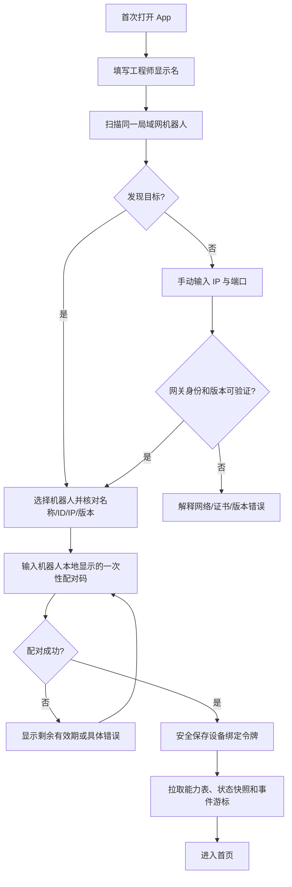
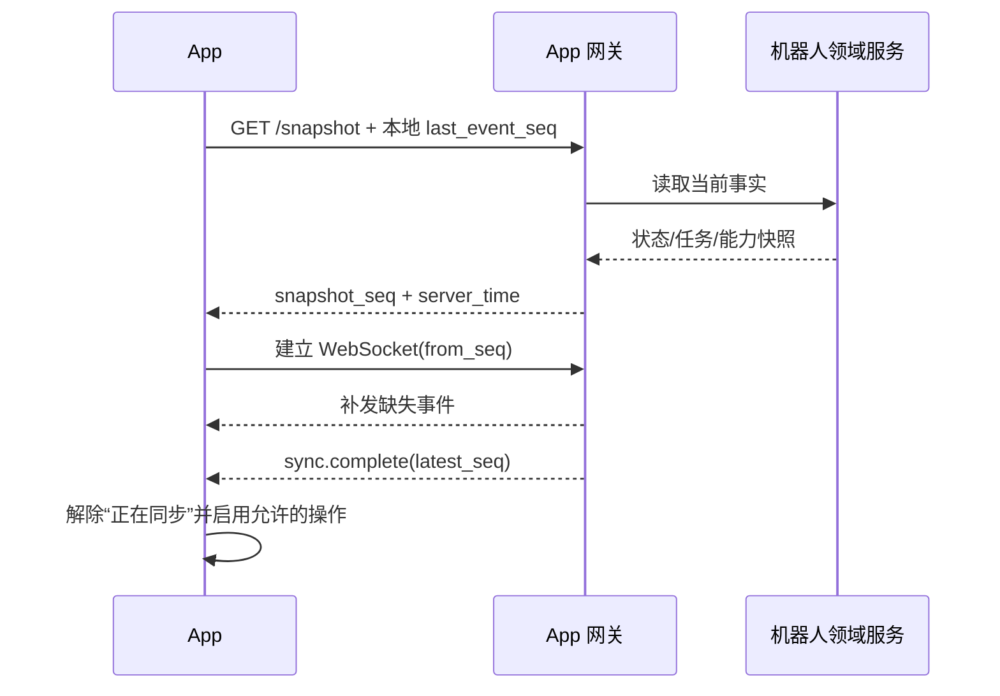
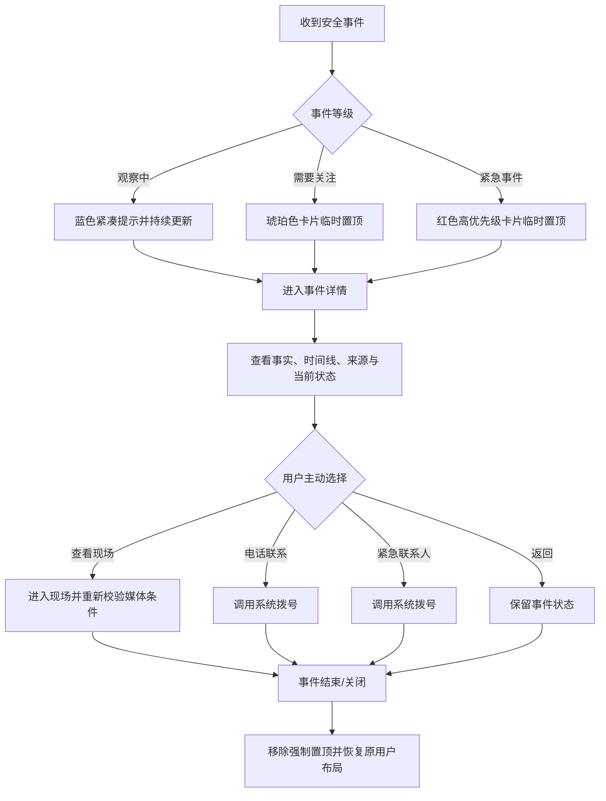
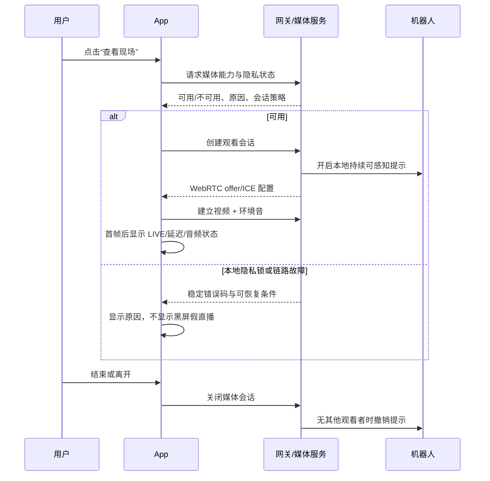
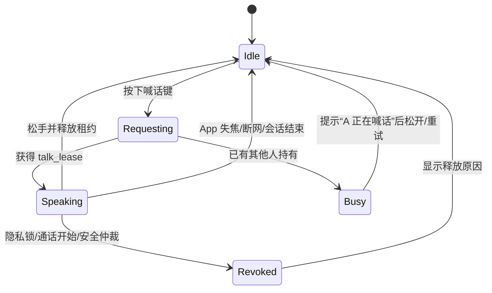
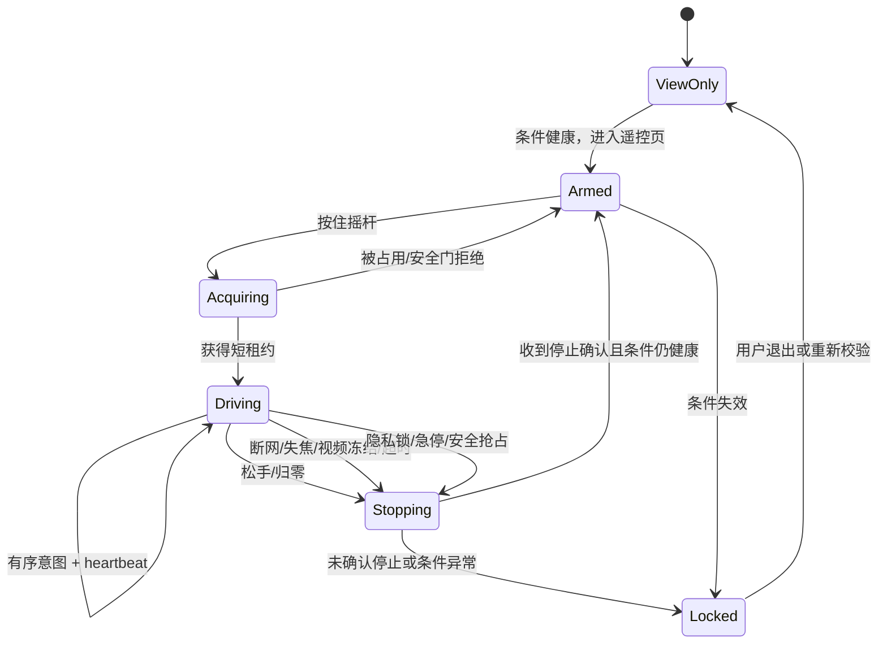
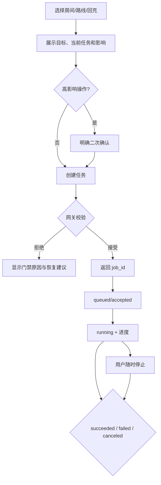
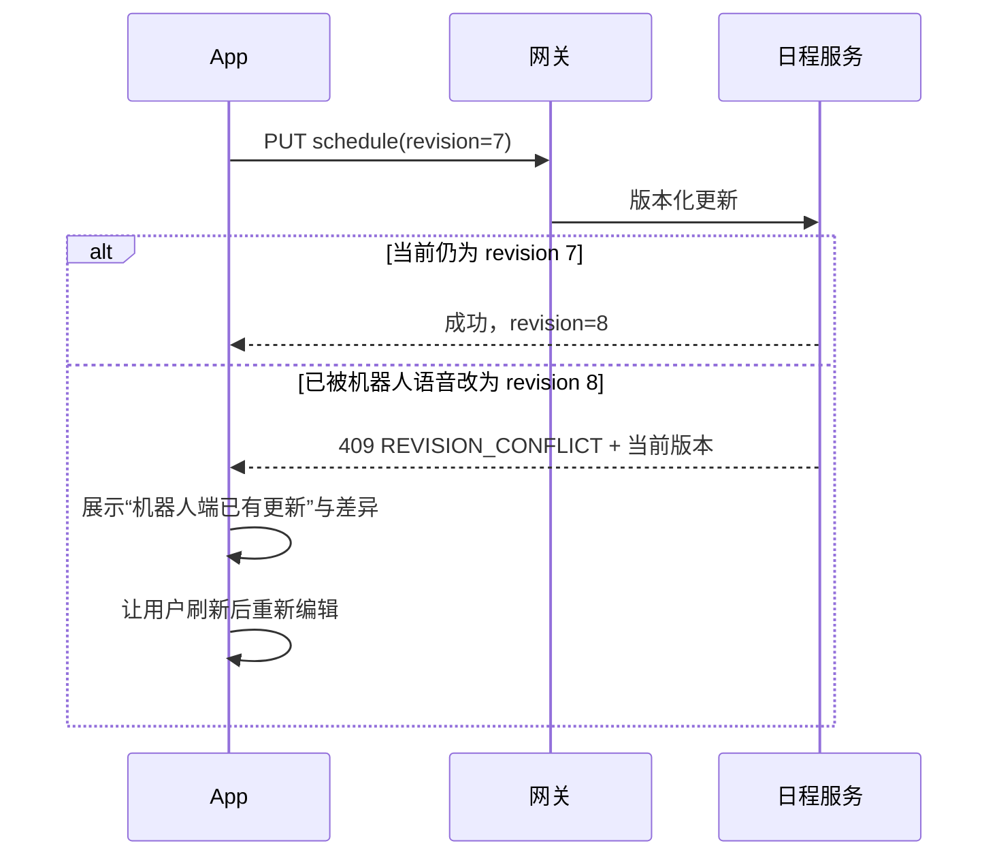
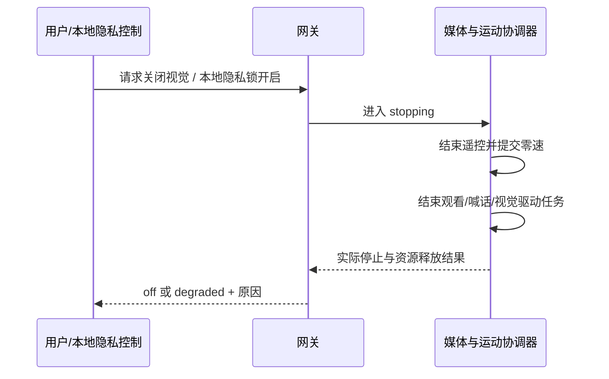

# 多乐守护关键体验流程

Status: `ready-for-human`

适用范围：`Engineering V1` 与 `Family Product`。带有“未来”的步骤不属于 Engineering V1
验收范围。

## 1. 通用交互约定

所有会改变机器人状态的流程遵循同一反馈模型：

```text
用户发起
  -> App 本地校验
  -> 网关接受或拒绝
  -> 机器人任务运行
  -> 明确终态
```

- “请求已发送”不能替代“已接受”或“已完成”。
- 写操作生成 `request_id` 和 `idempotency_key`；任务类操作还生成 `job_id`。
- 页面离开后，长任务继续由机器人管理，并在首页、机器人页和消息中心保持同一状态。
- 断线时禁止新写操作。无法确认结果的既有写操作显示“结果待核实”，重连后按 ID 查询，不能自动重发。
- 状态超过其 `stale_after_ms` 后显示“状态已过期”，不能沿用绿色正常样式。
- 用户文案解释下一步；工程错误码放在可展开详情中。

## 2. 首次连接与配对

### 2.1 Engineering V1



验收要点：

- 发现结果必须显示稳定 `robot_id`，不能仅以容易变化的 IP 识别设备。
- 配对码一次性、短时有效；错误次数受限，成功后立即失效。
- App 校验网关返回的机器人身份。手动 IP 不是跳过身份校验的后门。
- 能力表未完成前，首页允许浏览连接状态，但所有控制按钮保持禁用。
- 本地令牌撤销后，旧 App 连接必须在短时间内失效。

### 2.2 Family Product（未来）

家庭版在上述设备校验前增加手机号验证码登录，在首次绑定时要求扫描机器人二维码并在
机器人本地确认。新设备登录、敏感权限变更和高风险操作可要求系统生物识别。手机号登录
不能替代机器人本地的首次绑定确认。

## 3. 启动、重连与遗漏事件



断线规则：

1. WebSocket 断开即显示“连接中断”，媒体和遥控执行各自的失联安全流程。
2. App 使用带抖动的退避重连；网络恢复后目标为 5 秒内开始重连。
3. 重连先取快照，再从游标补拉事件；按 `event_id` 去重。
4. 命令不因重连自动重放。处于未知结果的命令按 `request_id` 查询。
5. 事件历史缺口超过网关保留窗口时，网关返回 `RESYNC_REQUIRED`，App 清空派生缓存并重新
   获取完整快照。
6. Engineering V1 只有 App 进程与局域网 WebSocket 存活时才尽力发本地通知；App 被系统
   杀死或离开局域网时不承诺通知。

## 4. 首页与动态安全事件

### 4.1 无活动事件

- 首页顶部只保留一条紧凑状态：“暂无需要处理的安全事件”或“安全状态暂不可用”。
- 用户可拖动、隐藏普通模块；连接状态条不可隐藏。
- “无事件”不等于“老人安全”，必须同时显示最近更新时间与监护覆盖状态。

### 4.2 有活动事件



- 点击通知先到事件详情，不能直接偷偷打开摄像头。
- App 只展示机器人端提供的“观察中 / 需要关注 / 紧急事件”，不根据概率自行升级或降级。
- 工程模式可展开原始来源和分数，但醒目标注“诊断信息，不是产品结论”。
- 家庭产品不提供事件认领、家属群聊或处置工单；家属通过电话自行协商。
- 用户可以确认“已看到”，但这不自动关闭机器人端事故。事件状态由其正式来源决定。
- Family Product 中，紧急通知若 60 秒内没有任一获授权接收者打开详情，触发短信兜底；
  去重键为 `incident_id + escalation_stage`。

## 5. 查看现场



约束：

- 打开画面即默认收听环境声音；环境音状态必须可见。
- 机器人本地以屏幕、指示灯或语音提供持续提示，不能只有进入瞬间的一声提示。
- 本地隐私锁可立即终止会话，App 无权绕过。
- 画面无新帧达到阈值时标为冻结并停止遥控资格；最后一帧必须蒙层标注，不能冒充实时。
- Engineering V1 仅支持一台手机。Family Product 才允许多人观看。
- 不提供 App 内截图、录像或回放；系统级截图/录屏不作为产品能力承诺。

## 6. 按住喊话

喊话和通话是两个独立按钮，不能合并成模糊的“麦克风”开关。



- 必须“先获得租约，再发送音频”；UI 不能在等待租约时显示正在喊话。
- 租约短时有效并持续保活；松手、锁屏、来电、系统麦克风失权或网络中断立即释放。
- Engineering V1 的忙碌提示可显示“另一客户端正在喊话”；Family Product 显示获授权成员的
  展示名，如“A 正在喊话中”。
- 机器人播放喊话期间，应暂停或抑制会被扬声器回声触发的 ASR 命令路径。

## 7. 全双工通话

Engineering V1 为 App 与机器人的一对一全双工音频；进入后机器人自动接通并做本地明显
提示，不要求老人操作机器人端。

```text
点击“开始通话”
  -> 检查麦克风权限、媒体链和机器人音频仲裁
  -> 若有人喊话，先结束/拒绝该喊话租约
  -> 建立双向语音
  -> 显示通话计时、静音、扬声器与结束按钮
  -> 任一方结束或链路不可恢复时关闭会话并恢复机器人语音策略
```

Family Product 的目标是机器人加最多 8 位家属，共 9 个端点：

- 家属可独立开关摄像头；关闭后以头像占位。
- 机器人屏幕按有效端点使用单行两格、四宫格、九宫格。
- 多人可同时发声，行为对标群视频通话；喊话互斥规则不适用于通话。
- 机器人屏幕链不可用时自动降级多人语音，App 明确提示降级原因。
- 加入、离开、静音和摄像头状态对所有参会者同步。

## 8. 手动遥控

### 8.1 进入条件

只有以下条件全部成立才显示“可以遥控”：

- 当前直播有连续新帧，端到端延迟低于门槛；
- 控制 WebSocket 健康，时钟偏差在允许范围；
- 本地隐私锁关闭且视觉策略允许；
- 导航/底盘/急停/定位等机器人安全门允许；
- 没有更高优先级运动 owner 或安全事件抢占；
- App 位于前台且屏幕保持唤醒。

### 8.2 租约状态机



### 8.3 输入与停止规则

- App 发送 `linear`、`angular` 范围 `[-1, 1]` 的归一化意图和递增 `seq`，不发送真实
  `m/s` 或 `rad/s`。
- 机器人端应用固定低速上限、加速度限制、防碰撞和运动仲裁；App 不提供提高上限入口。
- 摇杆回中、触点离开、页面失焦、App 后台、锁屏、来电、视频超过 800 ms、控制链断开、
  本地隐私锁开启或安全事件抢占，都必须结束非零意图。
- 摇杆一松，控制权立即释放；不设计“申请接管”流程。
- “立即停止”不要求持有遥控权，幂等且始终可用。停止后必须等待机器人确认；未确认时用
  红色阻断页提示工程师现场核查，不能恢复遥控。
- 任何自动任务开始前也必须确认没有活跃遥控租约。

## 9. 导航、巡逻与回充任务



- 同一 `job_id` 的状态只能向允许的终态前进；乱序事件不能让已失败任务重新显示运行中。
- 回充或替换当前任务必须展示会被取消的任务。
- 页面离开不取消任务；全局当前任务卡持续可见。
- 房间用稳定 `room_id` 提交，展示名只供 UI 使用。
- 立即巡逻必须限制轮数或最长时长，禁止默认无限执行。

## 10. 定时自动巡逻

1. 用户在“日程 > 定时巡逻”选择机器人端已验证路线、日期时间、重复规则、有限轮次和启停。
2. App 使用家庭时区显示，同时存储带时区的执行规则。
3. 网关保存到正式调度服务，并返回 revision 与下一次执行时间。
4. 到点由机器人重新检查定位、地图版本、电量、活动任务、隐私和安全门。
5. 条件满足则创建普通巡逻 `job_id`；不满足则记录 `skipped_by_gate` 和具体原因，绝不为
   追求准时绕过门禁。
6. Engineering V1 在 WS 在线时显示执行或跳过事件；离线后重连补拉。
7. 用户可自行决定是否启用和如何配置；产品不默认替家庭开启自动巡逻。

## 11. 日程新增、编辑与冲突

### 11.1 创建

```text
填写标题/时间/重复/确认策略
  -> 本地校验
  -> POST 创建
  -> 返回 schedule_id + revision
  -> 列表显示机器人端确认后的数据
```

### 11.2 编辑冲突



- 家属获授权后，日程编辑立即生效，不等待老人确认；机器人可以播报已变更。
- 需要确认的照护提醒状态为：已播报、已完成、稍后、跳过、未确认。
- 默认照护提醒在到点播报、5 分钟后重试、15 分钟仍未确认则通知家属；普通提醒默认不升级。
- 删除重复日程时明确选择“仅本次”或“整个系列”（若后端暂不支持例外实例，E1 应禁用
  “仅本次”并如实说明）。

## 12. 视觉隐私关闭



- App 请求关闭属于允许的安全方向；必须等待实际停止确认。
- App 请求开启时，如存在本地隐私锁，返回 `LOCAL_PRIVACY_LOCKED`，不弹出绕过选项。
- 关闭视觉不应伪造摄像头故障；策略关闭、本地锁、硬件故障分别显示。

## 13. 工程诊断导出

1. 工程师进入“我的 > 工程模式”，查看 App、网关、媒体、导航和接口版本。
2. 选择一个时间窗或 `request_id`/`job_id`/`incident_id`。
3. App 预览将导出的字段和脱敏规则。
4. 网关生成结构化 JSON/文本；App 加入自身日志摘要。
5. 用户通过系统分享面板自行保存或传递。

诊断包允许：时间戳、版本、能力、状态转移、延迟摘要、错误码、匿名设备 ID、请求关联 ID。
诊断包禁止：绑定令牌、验证码、原始音视频、完整电话、无关家庭成员资料、原始对话与转写。

## 14. Family Product 专属流程（未来）

### 14.1 成员与权限

- 管理员邀请成员；成员人数及管理员人数不设产品上限。
- “管理员 / 照护成员 / 关注成员”是治理身份和建议模板，业务能力最终按成员逐项授权。
- 管理员可以把全部家庭成员设为管理员。
- 权限变更需要再认证，记录审计并通知所有管理员；任一管理员可撤销成员或令牌。

### 14.2 通知偏好

- 每名成员分别配置事件类型、渠道、声音和免打扰。
- 系统始终要求至少一名成员保留紧急事件接收；最后一名不能关闭，除非先指定替代者。
- 普通设备故障只有持续存在或影响能力时才通知，瞬时抖动只记入状态历史。

### 14.3 首页个性化

- 每名成员保存自己的模块顺序、隐藏项和默认页，不强制全家共用布局。
- 活动安全事件是临时全局层，不受模块隐藏影响；结束后恢复该成员原布局。

## 15. 明确不设计的流程

- 事件工单认领、家属群聊和任务分派；
- 远程绕过本地隐私锁；
- App 录音、录像、回放、截图或屏幕录制管理；
- 原始对话、ASR 转写或“老人说了什么”历史；
- 生命体征、医疗建议或诊断；
- 修改底层地图、充电桩位姿、禁行区或导航参数；
- 远程提高机器人速度上限；
- Engineering V1 离开局域网后的通知保证。
